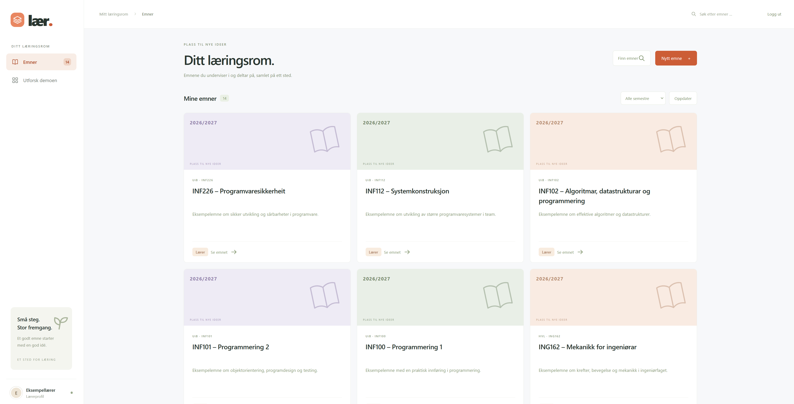
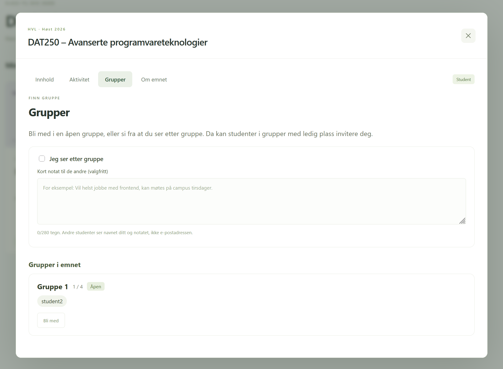

# Lær – DAT250 LMS (gruppe 1)

Lær er et læringsstyringssystem (LMS) utviklet som semesterprosjekt i DAT250 ved HVL/UiB høsten 2026.

## Beskrivelse
Lær lar lærere opprette emner med moduler, undervisningssider, quizer og filinnleveringer. Studenter finner emner i en katalog for HVL og UiB og melder seg på. Deretter tar de quizer, leverer oppgaver og får vurderinger og tilbakemeldinger. Hvert emne har en aktivitetsoversikt som oppdateres gjennom RabbitMQ.

Som egen funksjon («novel feature») har Lær **Finn gruppe**. Læreren oppretter grupper i emnet, og studentene kan bli med i åpne grupper. De kan også krysse av for at de *ser etter gruppe* og skrive et kort notat som de andre ser, slik at studenter i grupper med ledig plass kan invitere dem.

### Funksjoner
- **Brukere og innlogging**
  - Registrering med student- eller lærerprofil og passordkrav.
  - Innlogging med sesjon og CSRF-beskyttelse.
  - Ferdige demokontoer.
- **Emner og medlemskap**
  - Lærere oppretter og redigerer emner.
  - Emnekatalog for HVL og UiB med selvpåmelding.
  - Roller per emne.
- **Moduler og sider**
  - Markdown-sider med utkast og publisering.
  - Synlighet kan begrenses til et tidsrom.
  - Innhold kan sorteres.
- **Quiz**
  - Flervalg med automatisk retting, poeng og hint.
  - Begrenset antall forsøk og frist.
  - Læreren styrer når resultatene vises.
- **Filinnleveringer**
  - Levering av PDF og Word, med versjoner og regler for sen levering.
  - Karakter og tilbakemelding som utkast eller publisert.
- **Aktivitet**
  - Hendelser for quizforsøk, innleveringer og vurderinger.
  - Leveres via en transaksjonell outbox og RabbitMQ.
- **Grupper og Finn gruppe**
  - Læreren oppretter grupper og fordeler studenter.
  - Studentene kan bli med i åpne grupper, si fra at de ser etter gruppe, invitere og godta invitasjoner.

### Arkitektur
| Del | Teknologi |
| --- | --- |
| Frontend | React 19, TypeScript, Vite (`frontend/`) |
| Backend | Java 21, Spring Boot 4.1, Spring Web MVC, Spring Data JPA, Spring Security (`backend/`) |
| Database | PostgreSQL 17, med skjema styrt av Flyway (`backend/src/main/resources/db/migration`) |
| Fillagring | SeaweedFS via S3-protokollen (AWS SDK for Java) |
| Meldinger | RabbitMQ / Spring AMQP |
| Tester | JUnit, Spring Boot Test, MockMvc, Testcontainers |

Backend er delt i pakkene `course` (emner, medlemskap, katalog), `content` (moduler, sider, quiz, oppgaver), `group` (grupper og Finn gruppe), `events` (outbox og aktivitet), `storage` (S3), `user` (registrering og demodata) og `security`.

## Skjermbilder




## Installasjon
### Krav
- Java 21 eller nyere
- Node.js 20 eller nyere med npm
- Docker Desktop (eller Docker Engine med Compose)

### Oppsett
1. Klon repoet og lag en `.env`-fil i rotmappen:
   ```powershell
   copy .env.example .env
   ```
   Sett et passord i `.env`, for eksempel `POSTGRES_PASSWORD=lmspassword`.
2. Start PostgreSQL, SeaweedFS og RabbitMQ:
   ```powershell
   docker compose up -d
   ```
3. Start backend. 
   ```powershell
   cd backend
   .\mvnw.cmd spring-boot:run      # macOS/Linux: ./mvnw spring-boot:run
   ```
   Flyway oppretter og oppdaterer databasetabellene automatisk ved oppstart.
4. Start frontend i et nytt terminalvindu. Den kjører på http://localhost:5173:
   ```powershell
   cd frontend
   npm ci
   npm run dev
   ```

Stopp tjenestene med `docker compose stop`. Kommandoen `docker compose down -v` sletter også alle data.

## Bruk
Åpne http://localhost:5173. I lokal utvikling opprettes disse demokontoene automatisk, og de vises også på innloggingssiden:

| Rolle | E-post | Passord |
| --- | --- | --- |
| Lærer | `laerer@lms.test` | `demo123!` |
| Student | `student@lms.test` | `demo123!` |

Demolæreren har eksempelemner der demostudenten allerede er påmeldt. Du kan også registrere nye kontoer og melde deg på emner via **Finn emner**.

Slik prøver du Finn gruppe:
1. Logg inn som lærer, åpne et emne og velg fanen **Grupper**.
2. Opprett en åpen og en lukket gruppe.
3. Logg inn som student, gjerne i et privat vindu, og kryss av for **Jeg ser etter gruppe**.
4. Med en annen student kan du bli med i den åpne gruppen og invitere studenten som leter.

Nyttige adresser lokalt:
- RabbitMQ-administrasjon: http://localhost:15672
- SeaweedFS S3: http://localhost:8333

## Tester
```powershell
cd backend
.\mvnw.cmd verify               # integrasjonstester; krever at Docker kjører (Testcontainers)

cd frontend
npm run lint
npm run build
```
Testene starter sin egen PostgreSQL-container og påvirker ikke den lokale databasen.


## Roadmap
Gjenstående arbeid:
- **Gruppeinnlevering**: én innlevering på vegne av gruppen, og felles karakter og tilbakemelding.
- **Kodeoppgaver**: egen innholdstype med startkode, leveringsmåte, frist og vurdering.
- **Flere spørsmålstyper i quiz**, for eksempel utfylling, kobling og sortering.
- **Individuell lærertilbakemelding** på quizforsøk.
- **Fremdrift**: lesestatus og fullføring, og eventuelt avhengigheter mellom moduler.
- **Multimedia**, for eksempel innebygd video.


## Forfattere
DAT250, gruppe 1, høsten 2026:
- Adrian Nordbø
- Viktor Bouwer Knudsen
- Magnus Grønås
- Henrik Helmers

## Lisens
Prosjektet er laget som en del av et studieemne og har ingen åpen kildekode-lisens.

## Prosjektstatus
Prosjektet er under aktiv utvikling gjennom semesteret.
