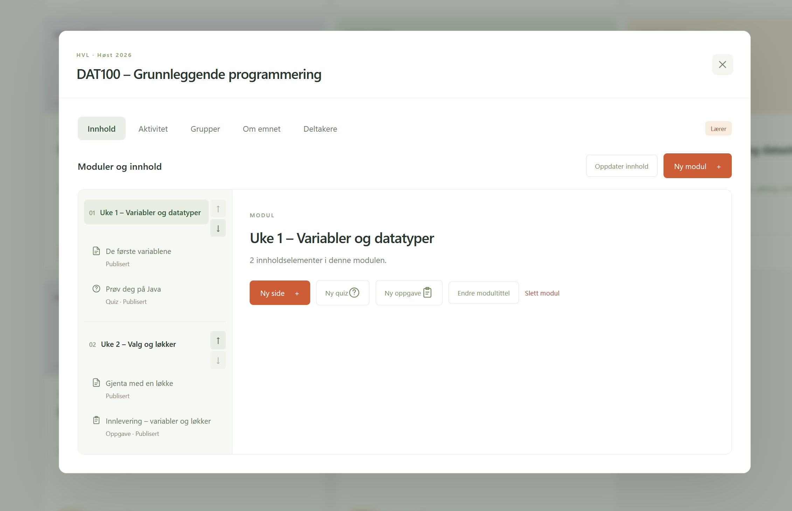

# Lær – DAT250 LMS (group 1)

Lær is a learning management system (LMS) developed as the semester project in DAT250 at HVL, autumn 2026.

## Description
Lær lets teachers create courses with modules, teaching pages, quizzes and file assignments. Students find courses in a catalogue for HVL and UiB and enrol. They then take quizzes, hand in assignments and receive grades and feedback. Each course has an activity feed that is updated through RabbitMQ.

As its own feature ("novel feature"), Lær has **Find a group** (*Finn gruppe*). The teacher creates groups in the course, and students can join open groups. They can also tick that they are *looking for a group* and write a short note that the others can see, so that students in groups with free spots can invite them.

### Features
- **Users and login**
  - Registration with a student or teacher profile and password requirements.
  - Login with session and CSRF protection.
  - Ready-made demo accounts.
- **Courses and membership**
  - Teachers create and edit courses.
  - Course catalogue for HVL and UiB with self-enrolment.
  - Roles per course.
- **Modules and pages**
  - Markdown pages with drafts and publishing.
  - Visibility can be limited to a time window.
  - Content can be reordered.
- **Quiz**
  - Multiple choice with automatic grading, points and hints.
  - Limited number of attempts and a deadline.
  - The teacher controls when results are shown.
- **File assignments**
  - Hand-in of PDF and Word, or a `.zip` of code for coding exercises, with versions and rules for late submission.
  - Optional link to a starter-code repository, and group assignments with one shared submission per group.
  - Grade and feedback as draft or published.
- **Activity**
  - Events for quiz attempts, submissions and grades.
  - Delivered through a transactional outbox and RabbitMQ.
- **Groups and Find a group**
  - The teacher creates groups and assigns students.
  - Students can join open groups, say that they are looking for a group, invite others and accept invitations.

### Architecture
| Part | Technology |
| --- | --- |
| Frontend | React 19, TypeScript, Vite (`frontend/`) |
| Backend | Java 21, Spring Boot 4.1, Spring Web MVC, Spring Data JPA, Spring Security (`backend/`) |
| Database | PostgreSQL 17, with the schema managed by Flyway (`backend/src/main/resources/db/migration`) |
| File storage | SeaweedFS via the S3 protocol (AWS SDK for Java) |
| Messaging | RabbitMQ / Spring AMQP |
| Tests | JUnit, Spring Boot Test, MockMvc, Testcontainers |

The backend is split into the packages `course` (courses, membership, catalogue), `content` (modules, pages, quizzes, assignments), `group` (groups and Find a group), `events` (outbox and activity), `storage` (S3), `user` (registration and demo data) and `security`.

## Screenshots




## Installation
### Requirements
- Java 21 or newer
- Node.js 20 or newer with npm
- Docker Desktop (or Docker Engine with Compose)

### Setup
1. Clone the repository and create a `.env` file in the root folder:
   ```powershell
   copy .env.example .env
   ```
   Set a password in `.env`, for example `POSTGRES_PASSWORD=lmspassword`.
2. Start PostgreSQL, SeaweedFS and RabbitMQ:
   ```powershell
   docker compose up -d
   ```
3. Start the backend.
   ```powershell
   cd backend
   .\mvnw.cmd spring-boot:run      # macOS/Linux: ./mvnw spring-boot:run
   ```
   Flyway creates and updates the database tables automatically on start-up.
4. Start the frontend in a new terminal window. It runs on http://localhost:5173:
   ```powershell
   cd frontend
   npm ci
   npm run dev
   ```

Stop the services with `docker compose stop`. The command `docker compose down -v` also deletes all data.

### Running everything in Docker
Instead of steps 3 and 4, the backend and frontend can also run as containers. Build and start the whole system:
```powershell
docker compose --profile app up -d --build
```
The app is then available at http://localhost:8080 (nginx serves the frontend and forwards `/api` to the backend).

CI builds images for the backend and frontend on every push to `main` and publishes them to the project's GitLab container registry. To deploy those images without building:
1. Uncomment `D250_REG` in `.env` (see `.env.example`).
2. Log in to the registry with a personal access token:
   ```bash
   cat ~/.gl_reg_token.txt | docker login git.app.uib.no:4567 -u <gitlab-username> --password-stdin
   ```
3. Pull and start:
   ```powershell
   docker compose --profile app pull
   docker compose --profile app up -d
   ```

## Usage
Open http://localhost:5173. In local development these demo accounts are created automatically, and they are also shown on the login page:

| Role | E-mail | Password |
| --- | --- | --- |
| Teacher | `laerer@lms.test` | `demo123!` |
| Student | `student@lms.test` | `demo123!` |

The demo teacher has example courses where the demo student is already enrolled. You can also register new accounts and enrol in courses through **Finn emner** (Find courses).

How to try Find a group:
1. Log in as a teacher, open a course and select the **Grupper** (Groups) tab.
2. Create one open and one closed group.
3. Log in as a student, preferably in a private window, and tick **Jeg ser etter gruppe** (I'm looking for a group).
4. With another student, you can join the open group and invite the student who is looking.

Useful local addresses:
- RabbitMQ management: http://localhost:15672
- SeaweedFS S3: http://localhost:8333

## Tests
```powershell
cd backend
.\mvnw.cmd verify               # integration tests; requires Docker to be running (Testcontainers)

cd frontend
npm run lint
npm run build
```
Locally, the tests start their own PostgreSQL, SeaweedFS and RabbitMQ containers with Testcontainers and do not affect the local database. The GitLab runner cannot start containers, so in CI the tests run against PostgreSQL, SeaweedFS and RabbitMQ started as GitLab services instead (see `.gitlab-ci.yml`).


## Documentation
Architecture, technology stack, development process, new technology, novel feature, known limitations and AI reflection: [docs/DOCUMENTATION.md](docs/DOCUMENTATION.md).


## Authors
DAT250, group 1, autumn 2026:
- Adrian Nordbø
- Viktor Bouwer Knudsen
- Magnus Grønås
- Henrik Helmers

## License
The project was made as part of a university course and has no open-source license.

## Project status
The project is under active development throughout the semester.
