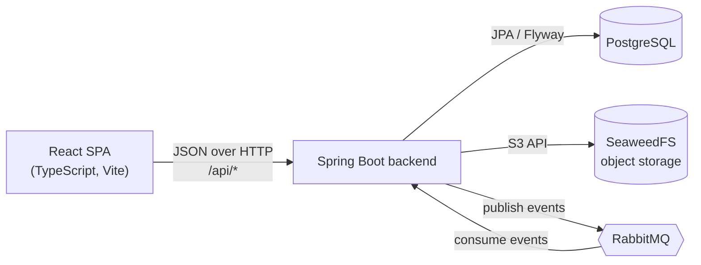
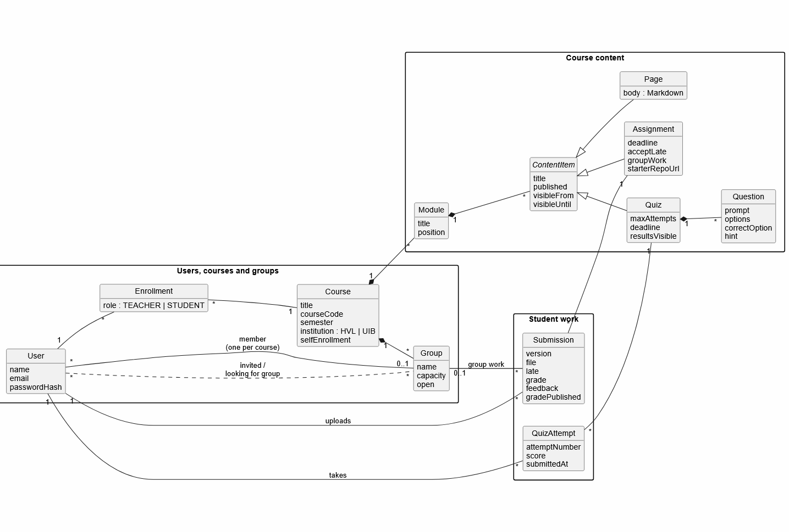

# Lær – project documentation

DAT250, group 1, autumn 2026. 

## Contents

1. [Overall architecture](#1-overall-architecture)
2. [Technology stack](#2-technology-stack)
3. [Thought and development process](#3-thought-and-development-process)
4. [New technology](#4-new-technology)
5. [Novel feature: Find a group](#5-novel-feature-find-a-group)
6. [Known limitations, bugs and shortcomings](#6-known-limitations-bugs-and-shortcomings)
7. [Reflection on the use of generative AI](#7-reflection-on-the-use-of-generative-ai)

---

## 1. Overall architecture

Lær is a web application with a React frontend and a Spring Boot REST backend. Supporting services run in Docker.

**Frontend.** A React app that talks to the backend only through `/api/*`. In development, Vite forwards these calls to the backend on port 8080. In the production image, nginx serves the built files and forwards `/api/` to the backend container.

**Backend.** Organised by feature rather than by layer:

| Package    | Responsibility |
|------------|----------------|
| `user`     | Registration, password rules, demo accounts and example content |
| `security` | Login/logout, sessions, CSRF and password hashing |
| `course`   | Courses, catalogue, enrolment and per-course roles (`CourseAccess`) |
| `content`  | Modules, pages, quizzes, assignments, submissions and grading |
| `group`    | Groups, Find a group and invitations |
| `storage`  | Storing and deleting submitted files in object storage |
| `events`   | Domain events, outbox publishing to RabbitMQ and the activity feed |
| `api`      | Shared error handling for the REST API |

Each feature follows the same pattern: a **controller** (REST endpoints), a **service** (business rules and access checks), and **repositories/entities** (persistence through JPA).

**Data storage.** Structured data lives in PostgreSQL: users, courses, content, attempts, grades, groups and events. The schema is defined by versioned Flyway migrations (`V1`–`V11`), and Hibernate only validates it. Submitted files are stored in SeaweedFS through the S3 protocol. The database keeps only the object key and metadata. If saving a submission fails after the upload, the uploaded file is deleted again, and when submissions are deleted later, a database trigger queues their files for removal by a scheduled cleanup job (`ObjectCleanup`).

**Security.** Users log in with e-mail and password through Spring Security at `/api/login`, which creates a server-side session. CSRF protection is enabled, and the frontend fetches a token from `/api/csrf`. API clients that authenticate every request with HTTP Basic are exempt from CSRF, since browsers never attach the `Authorization` header automatically. Passwords are hashed with PBKDF2-HMAC-SHA256 (600 000 iterations). Authorisation is per course: the user's role in the course (teacher or student), and for group assignments their group membership, decides what they can read, change, submit or grade. The backend checks this on every request, not only in the UI.

**Events and messaging.** When a student submits a quiz or an assignment, or a teacher publishes a grade, an event is written to the `event_outbox` table *in the same database transaction* as the change itself. `OutboxPublisher` sends pending events to a RabbitMQ topic exchange (`lms.events.v1`) and retries with increasing delay if RabbitMQ is down. `CourseActivityConsumer` reads the events from a queue and stores them in `course_activity`, which powers the activity feed. Duplicates are ignored by event ID, and messages that keep failing go to a dead-letter queue. This *transactional outbox* pattern means an event is never lost, and never sent for a change that was rolled back.

**Build and deployment.** GitLab CI builds and tests the backend and frontend on every push to `main` and in merge requests. It then builds Docker images for both and publishes them to the project's container registry (see section 2). The whole system can be started on a host with `docker compose --profile app up -d`.

### Domain model

### Main API endpoints

| Area        | Endpoints |
|-------------|-----------|
| Session     | `POST /api/register`, `POST /api/login`, `POST /api/logout`, `GET /api/session`, `GET /api/csrf` |
| Courses     | `GET/POST /api/courses`, `GET/PUT /api/courses/{id}`, `GET /api/courses/catalog`, `POST /api/courses/{id}/enroll`, `GET /api/courses/{id}/members`, `POST /api/courses/{id}/students` |
| Modules     | `GET/POST /api/courses/{c}/modules`, `PUT/DELETE …/modules/{m}`, `PUT …/modules/order` |
| Pages and items | `POST …/modules/{m}/pages`, `GET/PUT/DELETE …/pages/{p}`, `DELETE …/modules/{m}/items/{i}` (any content item, including quizzes and assignments), `PUT …/items/order` |
| Quizzes     | `POST …/modules/{m}/quizzes`, `GET/PUT …/quizzes/{q}`, `GET/POST …/quizzes/{q}/attempts` |
| Assignments | `POST …/modules/{m}/assignments`, `GET/PUT …/assignments/{a}`, `POST …/submissions`, `PUT …/submissions/{s}/grade`, `GET …/submissions/{s}/file` |
| Groups      | `GET/POST /api/courses/{c}/groups`, `PUT/DELETE …/groups/{g}`, `POST …/groups/{g}/members`, `DELETE …/groups/{g}/members/{u}`, `POST …/groups/{g}/join`, `PUT/DELETE …/groups/seeking`, `POST …/groups/{g}/invitations`, `POST …/groups/invitations/{i}/accept`, `DELETE …/groups/invitations/{i}` |
| Activity    | `GET /api/courses/{c}/activity` |

---

## 2. Technology stack

| Technology | Used for |
|------------|----------|
| Java 21, Spring Boot 4.1 | Backend |
| Spring Web MVC | REST endpoints with JSON |
| Spring Data JPA / Hibernate | Mapping entities to database tables |
| PostgreSQL 17 | Main database |
| Flyway | Versioned SQL migrations for the schema |
| Spring Security | Login, sessions, CSRF, authentication of API calls |
| PBKDF2 | Password hashing |
| Jakarta Bean Validation | Validating input such as registration and course data |
| SeaweedFS | Object storage for submitted files |
| AWS SDK for Java (S3) | Uploading, downloading and deleting files in SeaweedFS |
| RabbitMQ, Spring AMQP | Publishing and consuming domain events |
| React 19, TypeScript | Frontend |
| Vite | Frontend dev server and production build |
| react-markdown | Rendering pages and assignment texts written in Markdown |
| nginx | Serving the frontend and forwarding `/api/` in the production image |
| Maven (wrapper) | Building the backend and running tests |
| JUnit, Spring Boot Test, MockMvc | Backend, API, validation and access-control tests |
| Testcontainers | Throwaway PostgreSQL, SeaweedFS and RabbitMQ containers for tests, locally |
| ESLint, TypeScript compiler | Frontend linting and type checking |
| Docker, Docker Compose | Supporting services locally, and the whole system with the `app` profile |
| GitLab CI | Build, tests, test reports, SAST, secret detection and image publishing |
| Kaniko | Building Docker images in CI without a Docker daemon |

**The CI pipeline** (`.gitlab-ci.yml`):
- **`backend`:** runs `./mvnw verify` against PostgreSQL, SeaweedFS and RabbitMQ started by GitLab as services, and publishes JUnit reports that expire after one week. The course runner cannot start containers, so Testcontainers can't be used there. Instead, the tests connect to the services through `LMS_TEST_*` variables, and each test context gets its own database schema (`TestDatabaseConfiguration`). Locally, Testcontainers still starts all three.
- **`frontend`:** `npm ci`, lint and build.
- **`release-images`:** builds the backend and frontend images with Kaniko and publishes them to the project's container registry, tagged `latest` and with the commit hash.
- **`sast`, `secret_detection`:** GitLab's security scanning.

---

## 3. Thought and development process

We started by setting up the repository, GitLab CI with security scanning, and empty Spring Boot and React projects. 
From there we built the system in layers, starting with what everything else depends on: first the database setup with Docker and Flyway, then registration and login, then courses with per-course roles. 
Once that was in place, we added the actual learning content on top: 
modules and Markdown pages, quizzes, and file assignments with grading and object storage. 
RabbitMQ and the activity feed came next, followed by the course catalogue for HVL and UiB with self-enrolment.

We split the work in two. Half of the group built the main structure and the core features of the app. 
The other half took over the remaining parts, groups and the Find a group feature, group submissions and coding exercises, getting the backend tests running in CI, Dockerfiles and image publishing, and the README and documentation. 
In hindsight, the split worked for getting things done, but it meant that not everyone understood the whole codebase from the start. 
Next time we would review each other's work more along the way and keep changes smaller, so the whole group stays on the same page.

---

## 4. New technology

Our new technology is **Flyway**, a tool for database migrations. Database migrations were not part of the lectures: the ORM lectures let Hibernate generate the tables from the entities.

**What it is.** Flyway manages the database schema as a series of numbered SQL scripts (`V1__…sql`, `V2__…sql` and so on). On start-up it checks the table `flyway_schema_history` in the database to see which scripts have already run, and runs only the new ones, in order. Each script runs once, and Flyway refuses to start if an applied script has been changed afterwards (checked with a checksum).

**Why we chose it.** Letting Hibernate create and update tables (`ddl-auto=update`) is convenient early on, but it is hard to control: it never drops or renames anything safely, it can't express everything we needed, and different machines can end up with slightly different schemas. With Flyway:
- the schema is plain SQL in Git, so every change is reviewed like other code
- every developer, the CI pipeline and a deployed instance get exactly the same schema
- we can use PostgreSQL features that Hibernate can't generate from annotations, such as `CHECK` constraints, partial and case-insensitive unique indexes, and a trigger

**Where we used it.**
- `backend/src/main/resources/db/migration/` holds 11 migrations, `V1` (courses) to `V11` (group work and coding exercises). Each feature added its own migration instead of editing an old one.
- Hibernate runs with `spring.jpa.hibernate.ddl-auto=validate`. It no longer changes the schema, but checks at start-up that the entities match the tables Flyway created.
- Examples of SQL we could only write by hand:
    - `V7`: a PL/pgSQL trigger that queues deleted files for removal from object storage.
    - `V10`: a unique index on `lower(name)`, so two groups in a course can't have the same name in different letter cases.
    - `V11`: a partial unique index that only applies to group submissions.
- Tests and CI: every test context runs all migrations against an empty database, so each test run also checks that the migrations work from scratch. In CI, each test context gets its own schema, and Flyway is pointed at it with `spring.flyway.default-schema`.

**How well it worked.** Well. Adding a feature meant writing one new SQL file, and the app, the tests and CI all picked it up without manual steps. `validate` mode caught mismatches between entities and tables at start-up instead of at runtime. The main cost is discipline: an applied migration must never be edited, so even a small fix needs a new migration. Developers with an old local database sometimes need `docker compose down -v` to start fresh.

---

## 5. Novel feature: Find a group

**What it is.** In many LMSs only the teacher can put groups together. In Lær, students can find each other, while the teacher stays in control:

- **The teacher** creates groups in the course with a name, a maximum size, and whether the group is *open* or *closed*. The teacher can add and remove students and change the size limit.
- **Students** can join an open group with free spots, or leave their group.
- A student without a group can tick **"I'm looking for a group"** and write a short note (max 280 characters), for example their ambition level or when they're available. Other students see who is looking and their note, but not their e-mail address.
- Members of a group with free spots can **invite** someone who is looking. The invitee can accept or decline. Apart from the teacher adding them, this is the only way into a closed group.
- When a student joins a group, they are removed from the "looking" list and their other pending invitations are cleared.

**Why.** Finding a group is a real problem in project courses, especially in courses shared between HVL and UiB, where students don't know each other. The feature also ties into **group submissions**: an assignment can be marked as group work, and the group then hands in one shared submission that all members can see, with a shared grade and feedback.

**Where it is in the code.**
- Database: `V10__course_groups.sql` (groups, members, students looking for a group, invitations) and `V11__group_work_and_coding_assignments.sql` (group submissions).
- Backend: the `group` package, with `GroupService` for the rules and `GroupController` for the endpoints. The rules are enforced in the service. "One group per student per course" and "no duplicate invitations" are also backed by unique constraints in the database.
- Frontend: `components/CourseGroups.tsx`, the **Groups** tab in each course.
- Tests: `GroupTests.java`.

---

## 6. Known limitations, bugs and shortcomings

**Not implemented**
- **More question types:** quizzes only support multiple choice with one correct answer. Fill-in, matching and ordering are not supported.
- **Teacher comments on quiz attempts:** students get automatic hints, but the teacher cannot write a personal comment on a specific attempt.
- **Progress and module dependencies:** there is no stored read or completed status, and no unlocking of modules based on earlier ones. This is optional in the domain description.
- **Video:** Markdown pages support images and links, but not embedded video playback.

**Partly implemented**
- **Coding exercises** are an ordinary assignment with an optional link to a starter-code repository, and the code is handed in as a `.zip`. There is no separate content type, no submission straight from Git and no automatic test runs.
- **Membership changes after submission:** access to a group submission follows *current* group membership. A student who leaves the group after it has submitted loses access to the group's submission and grade, and a student who joins later gains it. If the group is deleted, the submission stays with the student who uploaded it. There is no rule that locks a group after submission.
- **Deployment:** CI builds and publishes the images, but deploying to a host is manual (`docker compose --profile app pull && docker compose --profile app up -d`). HTTPS is not set up, and secrets are set by hand in `.env`. 

---

## 7. Reflection on the use of generative AI

**Where and why we used it:** 
Generative AI was allowed in the creation of the project and we used it quite a lot. Most of the core features were generated by AI, aswell as CI and testing.
The main reason we used it a lot was to get a functioning project up and running fast.

**Tools:**
- Claude Code

**Quality assurance:**
A lot of tests were set up to check that everything works as intended, as well as a lot of hands-on testing to see that everything had the functionality we wanted it to have.

**Lessons learned:**
AI was very useful in setting up repetitive parts of the project. Next time we would like to use it less in the process of developing.